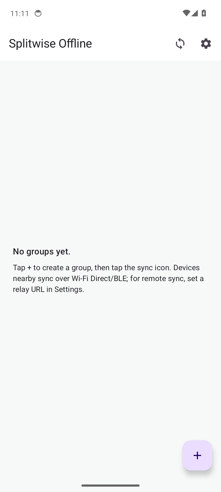
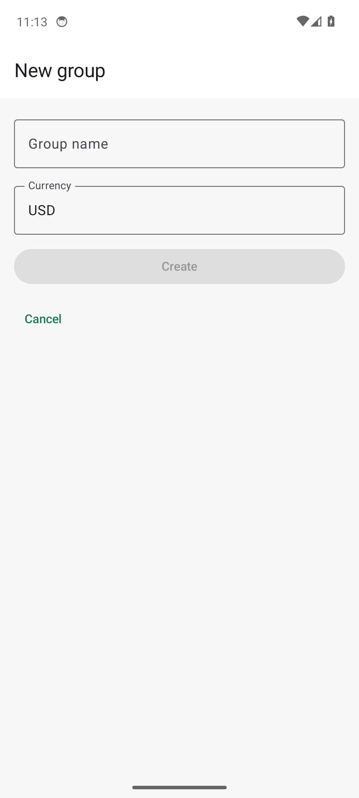
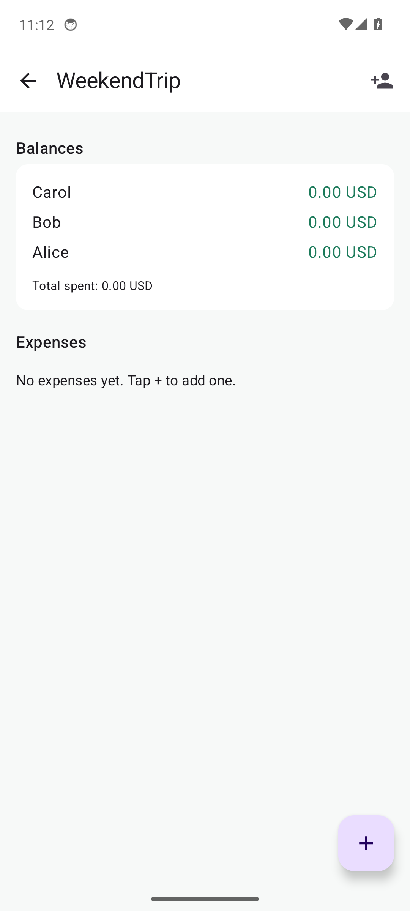
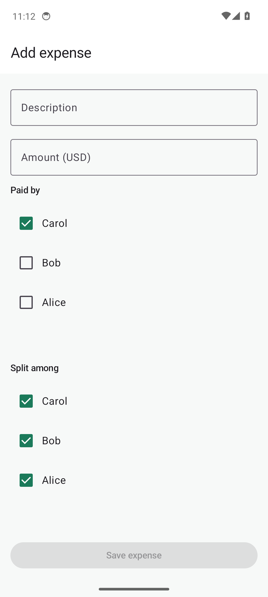
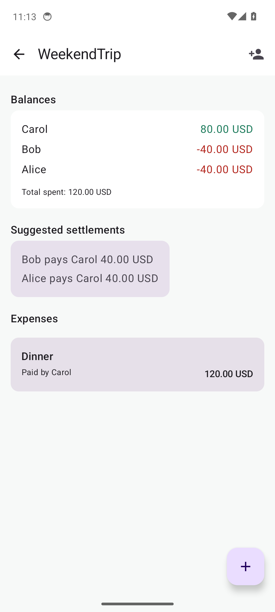
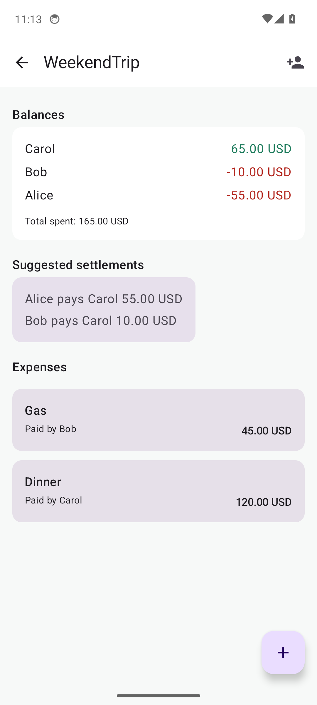
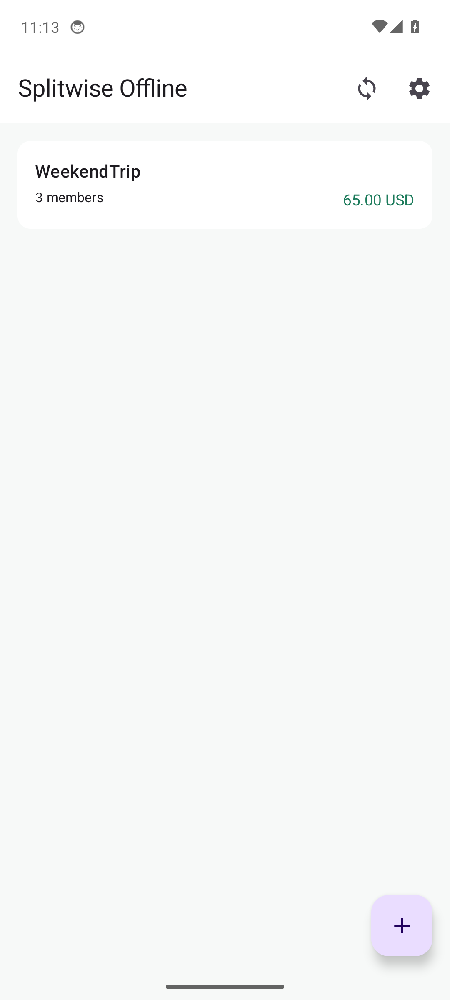
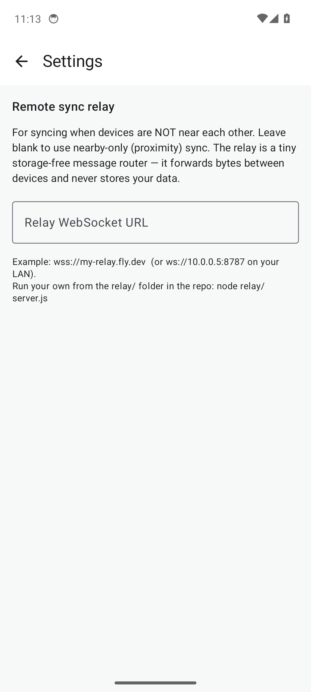
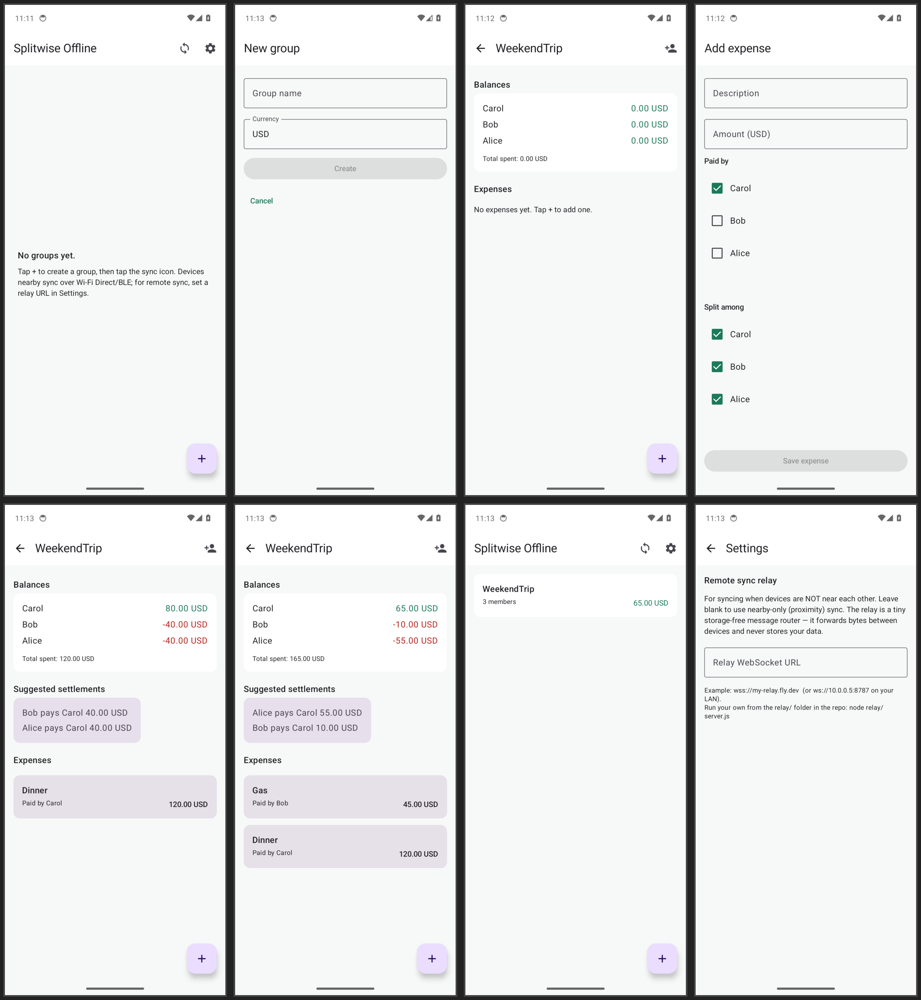

# Testing Splitwise Offline

How to build, run, and test the app — locally (unit tests), in the Android
emulator, and on a real phone. Screenshots of every screen are in
[`docs/screenshots/`](./screenshots/).

---

## 1. Prerequisites

| Tool | Version | Notes |
|---|---|---|
| JDK | **17** (Temurin or OpenJDK) | Kotlin 2.0 / AGP 8.7 require JDK 17. JDK 21+ works for the Gradle *daemon* but the Kotlin compiler cannot parse JDK 25 version strings, so pin 17 via `org.gradle.java.home` in `gradle.properties` if your system default is newer. |
| Android SDK | Platform 34 + Build-Tools 34.0.0 | `compileSdk = 34`, `targetSdk = 34`, `minSdk = 26`. |
| Node.js | 22 (only for the relay) | The relay is optional — only needed for remote (non-proximity) sync. |
| Hardware | x86_64 with VT-x/AMD-V | Needed for the emulator. Check with `ls /dev/kvm`. |

### Android Studio (easiest path)

1. Install **Android Studio Ladybug+** (it bundles JDK 17, the SDK, and the emulator).
2. **File → Open** the project root.
3. When prompted, accept the suggested SDK / Gradle sync.
4. Pick a device in the **Device Manager** (create an AVD: Pixel 6, API 34, Google APIs x86_64) and press **Run ▶**.

### Command-line only (CI-style)

```bash
# --- install the Android command-line tools ---
mkdir -p ~/android-sdk/cmdline-tools
cd ~/android-sdk/cmdline-tools
curl -fsSLo clt.zip \
  https://dl.google.com/android/repository/commandlinetools-linux-11076708_latest.zip
unzip -q clt.zip && mv cmdline-tools latest

export ANDROID_HOME=~/android-sdk
export PATH=$ANDROID_HOME/cmdline-tools/latest/bin:$ANDROID_HOME/platform-tools:$ANDROID_HOME/emulator:$PATH
export JAVA_HOME=/usr/lib/jvm/java-17-openjdk-amd64   # adjust to your JDK 17

yes | sdkmanager --licenses
sdkmanager "platform-tools" "platforms;android-34" "build-tools;34.0.0" \
            "emulator" "system-images;android-34;google_apis;x86_64"

# --- tell Gradle where the SDK is ---
echo "sdk.dir=$ANDROID_HOME" > local.properties

# --- pin JDK 17 for the Gradle daemon (important if your default JDK is 21/25) ---
# gradle.properties already contains:
#   org.gradle.java.home=/path/to/jdk-17
# edit it to point at *your* JDK 17 install.
```

---

## 2. Build

```bash
# debug APK (outputs: app/build/outputs/apk/debug/app-debug.apk)
./gradlew :app:assembleDebug

# release bundle/APK (needs a signing config — out of scope for this POC)
./gradlew :app:assembleRelease
```

The debug APK is ~18 MB. The build runs KSP (Hilt + Room codegen) and the
Compose compiler, so the first run takes a few minutes; subsequent builds are
cached.

---

## 3. Unit tests (pure-JVM, no device needed)

The CRDT data layer has convergence proofs that run on the JVM — no emulator
required:

```bash
./gradlew :app:testDebugUnitTest
```

Expected: **12 tests pass** (VectorClock, LWWField, ORSet, BalanceCalculator,
and the CRDT merge/convergence suites). This is what the GitHub Actions
[`android`](../.github/workflows/build.yml) job runs on every push.

---

## 4. Emulator (headless or with window)

### Create an AVD

```bash
echo "no" | avdmanager create avd \
  -n splitwise_avd \
  -k "system-images;android-34;google_apis;x86_64" \
  -d pixel_6 --force
```

### Boot it

```bash
# headless (no GUI — good for CI / screenshots)
emulator -avd splitwise_avd \
  -no-window -no-audio -no-snapshot -no-boot-anim \
  -gpu swiftshader_indirect -wipe-data -port 5554 &

# OR with a window (interactive)
emulator -avd splitwise_avd -gpu host -port 5554 &
```

Wait for boot:

```bash
adb wait-for-device
until [ "$(adb shell getprop sys.boot_completed | tr -d '\r')" = "1" ]; do sleep 2; done
echo "booted"
```

### Install & launch

```bash
adb install -r app/build/outputs/apk/debug/app-debug.apk
adb shell monkey -p dev.splitwise.offline -c android.intent.category.LAUNCHER 1
```

### Take screenshots

```bash
adb exec-out screencap -p > screenshot.png
```

### Drive the UI from `adb` (no touch screen needed)

The app is a Jetpack Compose app with no resource IDs, so drive it by
coordinates obtained from a UI-automator dump:

```bash
# dump the view hierarchy with bounds
adb shell uiautomator dump /sdcard/ui.xml && adb pull /sdcard/ui.xml
# then tap the centre of a target element's [x1,y1][x2,y2] bounds:
adb shell input tap <cx> <cy>
adb shell input keyboard text "WeekendTrip"
adb shell input keyevent KEYCODE_BACK     # hide keyboard
```

A full walkthrough script (create group → add members → add expenses → check
balances) is in [`docs/walkthrough.sh`](./walkthrough.sh).

---

## 5. Real Android phone

1. Enable **Developer options** on the phone (Settings → About → tap Build
   number 7×).
2. Enable **USB debugging** and plug the phone in. Run `adb devices` — you
   should see your device.
3. `adb install -r app/build/outputs/apk/debug/app-debug.apk`
4. Open **Splitwise Offline** from the launcher.

> **Permissions**: on first launch, Android will prompt for
> `ACCESS_FINE_LOCATION` and `NEARBY_WIFI_DEVICES` — these are required by
> Nearby Connections for Wi-Fi Direct/BLE discovery. Grant them.
> Location is only used for the Nearby API discovery handshake
> (`neverForLocation` is set in the manifest); the app does not track you.

### Two-phone P2P sync test (the real point of the app)

1. Install on **two** phones on the **same Wi-Fi**.
2. On phone A: create a group, add members, add an expense.
3. On phone B: create the **same** group name (or just open the app).
4. On **both** phones tap the **Sync** icon in the top bar.
5. Accept the Nearby Connections pairing prompt on both.
6. The CRDT state converges — phone B now shows A's expenses and the balances
   match.

> Nearby Connections does not work in the emulator (no real Wi-Fi Direct / BLE
> radio), so P2P sync can only be tested on real hardware or with the relay
> transport below.

---

## 6. Remote relay sync (two devices on different networks)

The relay is a ~60-line Node.js WebSocket router — it forwards bytes between
devices in the same "room" and stores **nothing**.

```bash
cd relay
npm install        # or: npm ci (uses package-lock.json)
npm start          # listens on $PORT or 8787
```

Smoke test:

```bash
PORT=18787 node server.js &
curl -sf http://localhost:18787/health   # → "ok"
kill %1
```

Deploy options (all free-tier friendly):
- **Fly.io / Render / Railway**: push the `relay/` folder, set `PORT`, done.
- **$5 VPS**: `node relay/server.js` behind nginx + Let's Encrypt for `wss://`.
- **Docker**: `docker build -t splitwise-relay relay/ && docker run -p 8787:8787 splitwise-relay`.
- **Skip it**: leave the relay URL blank in Settings → proximity-only sync.

In the app: **Settings → Relay WebSocket URL** → enter e.g.
`wss://my-relay.fly.dev` → tap **Sync** on both devices.

---

## 7. What each screen looks like

All screenshots below were captured from a Pixel 6 / API 34 emulator running
the debug APK built from `master`. The app was driven through `adb input` to
create a "WeekendTrip" group with 3 members (Carol, Bob, Alice) and two
expenses (Dinner €120 paid by Carol, Gas €45 paid by Bob).

| # | Screen | Screenshot |
|---|---|---|
| 1 | Groups list (empty) |  |
| 2 | New group form |  |
| 3 | Group detail (members added) |  |
| 4 | Add expense form |  |
| 5 | Group detail (one expense, balances + settlements) |  |
| 6 | Group detail (two expenses) |  |
| 7 | Groups list (with data) |  |
| 8 | Settings (relay URL) |  |

**Contact sheet** (all 8 screens at a glance):


### What the screenshots demonstrate

- **Screen 1 / 7**: The groups list with an empty state and a populated state
  showing the group card (name, member count, total owed).
- **Screen 2**: Creating a group requires only a name and a currency code.
- **Screen 3**: After adding 3 members, each shows a `0.00 USD` balance.
- **Screen 4**: The add-expense form: description, amount, "Paid by" (radio,
  defaults to first member), "Split among" (checkboxes, defaults to all), and a
  live `Save expense · 120.00 USD` button label.
- **Screen 5**: After one expense (Dinner 120, Carol pays, split 3 ways):
  Carol +80, Bob −40, Alice −40, with suggested settlements
  "Bob pays Carol 40", "Alice pays Carol 40".
- **Screen 6**: After a second expense (Gas 45, Bob pays, split 3 ways):
  Carol +65, Bob −10, Alice −55, total spent 165, settlements updated.
- **Screen 8**: Settings screen with the relay WebSocket URL field and a hint
  pointing at the bundled `relay/server.js`.

---

## 8. CI

The GitHub Actions workflow
[`.github/workflows/build.yml`](../.github/workflows/build.yml) runs two jobs on
every push/PR:

- **android**: `./gradlew :app:assembleDebug :app:testDebugUnitTest` — builds the
  APK and runs the 12 unit tests, then uploads the APK as an artifact.
- **relay**: `npm ci`, `node -c server.js` (syntax check), and a health-check
  smoke test against a locally-started relay.

Both are green on `master`.